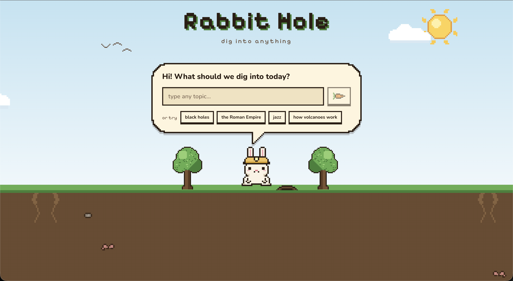

# Rabbit Hole

A learning game: type any topic, read a short layer about it, and answer a
question to dig deeper. Get it wrong and the idea gets re-explained a
different way (a "cave-in") before you try again. Dig as deep as you can
and collect an artifact at each layer.



## Architecture

- **Frontend** — React (Vite), talks only to the backend's HTTP API.
- **Backend** — FastAPI (`backend/api/`). Holds run state in memory and
  calls the LLM layer for content.
- **LLM layer** (`backend/LLM/`) — generates each layer, question, and
  cave-in by calling a model hosted on Databricks.
- **Delta tables** — every run/answer/cave-in is also logged to Delta
  tables in Databricks for analytics (`backend/api/storage.py`), with
  dashboard queries in `notebooks/dashboard_queries.sql`.

## Setup

```bash
git clone <https://github.com/Charlieotracy/Rabbit_Hole>
cd Rabbit_Hole

python3 -m venv .venv
source .venv/bin/activate   # <-- don't skip this; forgetting it is the
                             #     most common way this setup breaks
pip install -r backend/requirements.txt

cp .env.example .env
# edit .env and fill in DATABRICKS_TOKEN (everything else is prefilled)
```

**Run the backend** (from the repo root, with `.venv` active):

```bash
uvicorn backend.api.main:app --reload --port 8000
```

**Run the frontend** (separate terminal):

```bash
cd frontend
npm install   # requires Node 22, see frontend/.nvmrc
npm run dev
```

Open http://localhost:5173. (See `frontend/PLAN.md` for frontend architecture.)

By default `.env` has `FAKE_LLM=0`, so the backend makes real model calls.
Set `FAKE_LLM=1` instead for canned, instant content with no model calls —
useful for frontend work. See `API.md` for the full endpoint reference.

Note: the backend stores runs in memory, so restarting it loses all runs
in progress.
